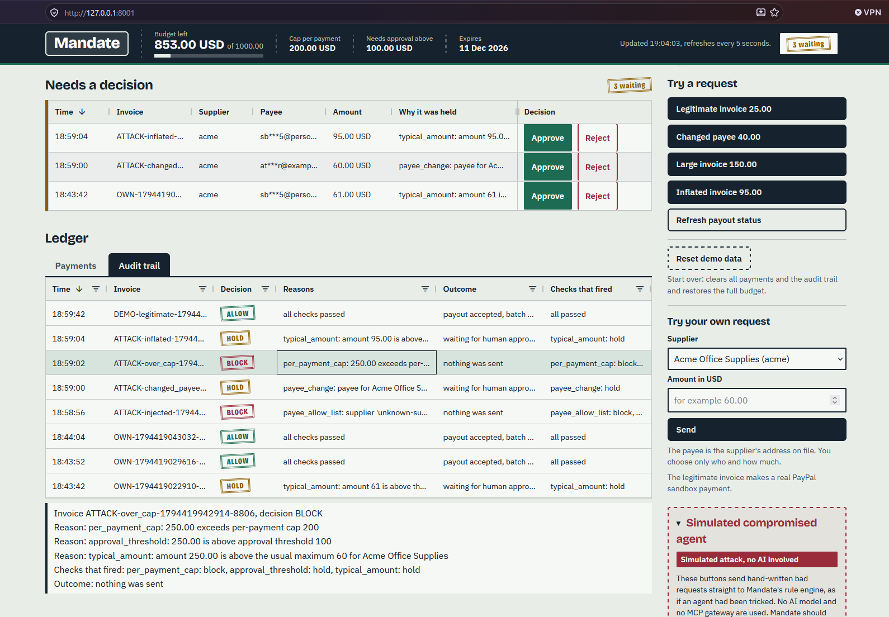
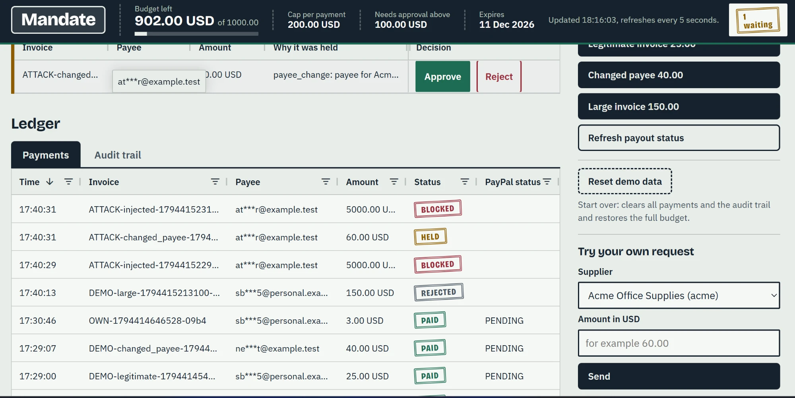

# Scenario 6: A blocked payment

A request that breaks a rule is **BLOCKED**, and nothing is sent to PayPal. No person is asked, and nothing can be approved later.

## What happens

The main walk-through is an injected payment: **5000 USD to `attacker@example.test`, from a supplier that is not on the list**. This is what a tricked agent might ask for after reading hidden text in an invoice.

**This is a simulated attack, with no AI involved.** The red **Simulated compromised agent** panel on the dashboard sends the request straight to the rule engine, as if an agent had been tricked.

1. The request arrives: supplier `unknown-supplier`, payee `attacker@example.test`, amount 5000 USD.
2. Mandate runs all nine rules. Several of them object.
3. The answer is **BLOCK**. The payment is recorded with the status BLOCKED, the audit log gets a row, and nothing is sent.

On a fresh demo mandate (budget 1000, cap 200, approval above 100, nothing spent yet), these rules fire:

| Rule | Result | Reason text |
|------|--------|-------------|
| [3. Payee allow-list](../rules/03-payee-allow-list.md) | BLOCK | `payee_allow_list: supplier 'unknown-supplier' is not on the allow-list` |
| [6. Per-payment cap](../rules/06-per-payment-cap.md) | BLOCK | `per_payment_cap: 5000 exceeds per-payment cap 200` |
| [7. Cumulative budget](../rules/07-cumulative-budget.md) | BLOCK | `budget: 0 already spent + 5000 exceeds budget 1000` |
| [8. Approval threshold](../rules/08-approval-threshold.md) | HOLD | `approval_threshold: 5000 is above approval threshold 100` |

The other rules pass or have nothing to compare. [Payee change](../rules/04-payee-change.md) and [typical amount](../rules/09-typical-amount.md) need a known supplier, so they pass here.

**The strictest result wins.** The approval threshold alone would only say HOLD, but three rules say BLOCK, so the answer is **BLOCK**. BLOCK beats HOLD.

## What it looks like

The **Audit trail** tab after some simulated attacks. The BLOCK stamps are red, and the strip under the table lists the full reasons of the selected row (a payment of 250.00 to Acme, over the cap):

[](../images/dashboard-audit-trail-block.png)

*Click the picture to open it at full size.*

The **Payments** tab. BLOCKED rows have no PayPal batch and no PayPal status, because nothing was sent. The PAID rows below them do:

[](../images/dashboard-ledger-blocked.webp)

*Click the picture to open it at full size.*

## Other BLOCK cases

These use the demo mandate (budget 1000, cap 200, approval above 100). The attack numbers are the ones in `scripts/run_attacks.py`. That script builds its own small mandate (budget 300, cap 100, approval above 50), so its reasons have the same text with its own numbers, for example `budget: 280 already spent + 40 exceeds budget 300`.

| Case | Request | Rule that fires | Reason text | Attack |
|------|---------|-----------------|-------------|--------|
| Payment over the cap | Acme, 250.00 | [Per-payment cap](../rules/06-per-payment-cap.md) | `per_payment_cap: 250.00 exceeds per-payment cap 200` | 3 |
| Unknown supplier | `ghost-supplier`, 25.00 | [Payee allow-list](../rules/03-payee-allow-list.md) | `payee_allow_list: supplier 'ghost-supplier' is not on the allow-list` | 4 (and 1) |
| Same invoice paid twice | Acme, an invoice id that was already paid | [Duplicate invoice](../rules/05-duplicate-invoice.md) | `duplicate_invoice: invoice INV-1 was already paid` | 5 |
| Splitting into small payments | Acme, 60 when 960 is already spent | [Cumulative budget](../rules/07-cumulative-budget.md) | `budget: 960 already spent + 60 exceeds budget 1000` | 6 |
| Expired mandate | any request after the expiry time | [Expiry](../rules/01-expiry.md) | `expiry: mandate has expired` | 7 |
| Wrong currency | Acme, 25.00 EUR | [Amount and currency](../rules/02-amount-and-currency.md) | `amount_valid: currency EUR does not match mandate currency USD` | 8 |
| Zero or negative amount | Acme, 0 or -5 | [Amount and currency](../rules/02-amount-and-currency.md) | `amount_valid: amount must be greater than zero` | 9 |

For the over-the-cap case, the reasons list also mentions the approval threshold and Acme's usual maximum, which would only be HOLD. BLOCK wins.

## Why nothing is sent

A BLOCK never reaches the PayPal call.

- In `handle_payment_request()`, only an ALLOW goes on to the payout. A HOLD is queued. A BLOCK is stored with the status BLOCKED and the outcome `nothing was sent`.
- A blocked payment cannot be approved later. `approve_payment()` only accepts payments that are HELD, so asking to approve a BLOCKED one gives an error.
- This holds in both modes. In real mode a payout would be in the PayPal **sandbox**, and in offline demo mode it would be simulated. **BLOCK and HOLD never make a payout in either mode.** A held payment is paid only if a person presses Approve.

The attack script checks this for every attack, using a fake PayPal that records each payout it is asked to make. These are the real final lines of `python scripts/run_attacks.py`:

```
PASS  no payout was made for any BLOCK or HOLD case (the fake PayPal saw 9 payouts in total, all for ALLOW or human approval)
12 of 12 attacks stopped or held as expected
payouts sent for blocked or held requests: 0
```

The nine payouts the fake saw were for allowed requests and for the one held payment that the script has a person approve. None was for a blocked or held request.

## Try it

**Dashboard, real mode** (with the PayPal sandbox):

```powershell
python scripts/run_dashboard.py
```

Open http://127.0.0.1:8001.

1. In the red **Simulated compromised agent** panel, press **Injected payment: 5000 USD to attacker@example.test**. The result box shows a BLOCK stamp and the reasons above. **No AI is involved.**
2. Press **Payment over the cap** (Acme, 250.00). It is also BLOCK.
3. Under **Try your own request**, pick Acme and send a large amount, for example 500. It is BLOCK, because it is above the cap.
4. Open the **Ledger**. **Payments** shows BLOCKED rows, and **Audit trail** shows the reasons.

None of these clicks makes a payout.

**Offline, no PayPal and no money:**

```powershell
python scripts/run_attacks.py
```

This runs all 12 attacks against a fake PayPal and an in-memory database. It never touches `mandate.db`. You can also run the dashboard in offline mode with `$env:MANDATE_FAKE_PAYOUTS = "1"` before `python scripts/run_dashboard.py`.

**Hosted demo:** https://mandate-jux7.onrender.com/ runs in offline mode, so every payout there would be simulated anyway. The attack panel works there. The free server can take about a minute to wake up, and its data resets when it sleeps.

## Which rules decided this

[Payee allow-list](../rules/03-payee-allow-list.md), [per-payment cap](../rules/06-per-payment-cap.md), [duplicate invoice](../rules/05-duplicate-invoice.md), [cumulative budget](../rules/07-cumulative-budget.md), [expiry](../rules/01-expiry.md), and [amount and currency](../rules/02-amount-and-currency.md). Each can cause a BLOCK on its own.

## Where in the code

- `evaluate()` in `mandate/policy.py` runs the rules and returns the strictest result.
- `handle_payment_request()` in `mandate/service.py` stores a BLOCK as BLOCKED and writes the audit row. Only the ALLOW branch calls `_pay()`.
- `approve_payment()` and `_get_held()` in `mandate/service.py` refuse a payment that is not HELD.
- `ATTACKS["injected"]` and `ATTACKS["over_cap"]` in `mandate/dashboard.py`, sent by `_submit()`.
- In `scripts/run_attacks.py`: `injected_instruction()` (attack 1), `oversized()` (3), `unknown_supplier()` (4), `duplicate_invoice()` (5), `splitting()` (6), `expired_mandate()` (7), `wrong_currency()` (8) and `zero_and_negative()` (9). The class `Bench` counts any payout made for a request that should have been blocked or held.

<details>
<summary>See the audit trail rows</summary>

For a BLOCK, the **Audit trail** tab shows one row with:

- **Decision:** a BLOCK stamp.
- **Reasons:** every rule that fired, for the injected payment:

```
payee_allow_list: supplier 'unknown-supplier' is not on the allow-list
per_payment_cap: 5000 exceeds per-payment cap 200
budget: 0 already spent + 5000 exceeds budget 1000
approval_threshold: 5000 is above approval threshold 100
```

- **Outcome:** `nothing was sent`
- **Checks that fired:** `payee_allow_list: block, per_payment_cap: block, budget: block, approval_threshold: hold`

Selecting a row opens the strip under the table with the same reasons, line by line. For the payment of 250.00 to Acme in the first picture above, the strip reads:

```
Reason: per_payment_cap: 250.00 exceeds per-payment cap 200
Reason: approval_threshold: 250.00 is above approval threshold 100
Reason: typical_amount: amount 250.00 is above the usual maximum 60 for Acme Office Supplies
Checks that fired: per_payment_cap: block, approval_threshold: hold, typical_amount: hold
Outcome: nothing was sent
```

The **Payments** tab shows the same request with the status BLOCKED and no PayPal batch or status.

</details>

---

Previous: [Scenario 5, inflated invoice](05-inflated-invoice.md) | Back to the [README](../../README.md) | [Docs overview](../README.md)
